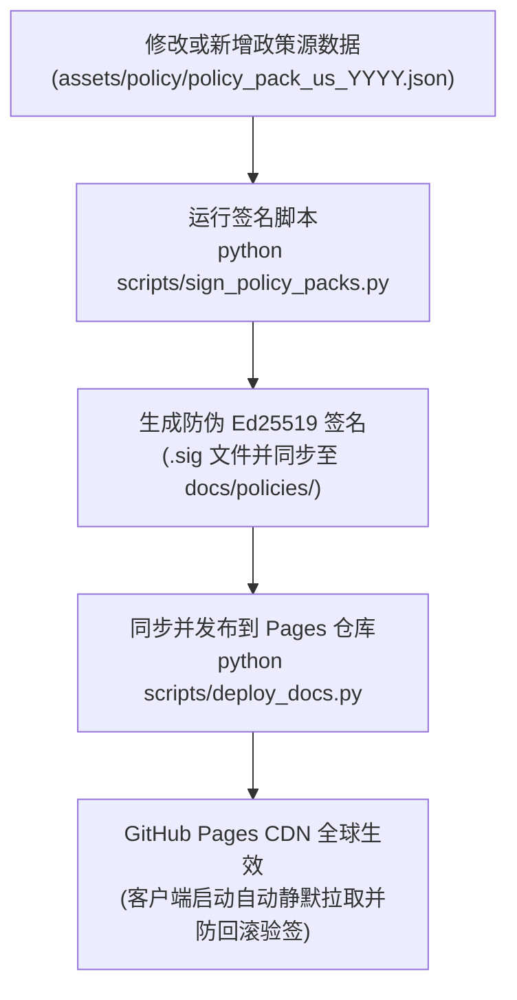

# TipCap 官方站点与 OTA 政策 CDN 部署运维说明文档

本文档详细记录 TipCap 官方落地页、隐私政策协议以及 OTA 零运维税收政策包（Policy Pack CDN）的双仓库托管架构、更新与一键同步上线全流程，供长期维护与快速交接查阅。

---

## 一、双仓库托管架构与背景原理

### 1.1 架构设计背景
- **主工程仓库 (`wee91681-ops/tipcap`)**：为 **Private（私有）仓库**，存放商业源码、Flutter 跨平台代码、iOS/Android 原生工程及私有 CI/CD。
- **限制**：在 GitHub Free 免费计划下，**私有仓库不支持直接启用 GitHub Pages**（开启需要企业版或付费 Pro 席位）。
- **解法**：设立专属公开静态托管仓库 **`wee91681-ops/wee91681-ops.github.io`**（Public 顶级用户站点），利用其自动免费提供的 GitHub Pages 服务作为对外静态门户与 CDN 节点。

### 1.2 目录映射与线上访问路由

| 本地源码目录 (`Tipcap/docs/`) | 公开仓库目录 (`wee91681-ops.github.io/`) | 线上最终对外生产访问 URL | 用途说明 |
| :--- | :--- | :--- | :--- |
| `docs/index.html` | `tipcap/index.html` | `https://wee91681-ops.github.io/tipcap/index.html` | App 落地页、4 语介绍与 App Store 官方支持页 |
| `docs/privacy.html` | `tipcap/privacy.html` | `https://wee91681-ops.github.io/tipcap/privacy.html` | 双端上架必备隐私政策协议（含 Apple & Google 订阅说明） |
| `docs/policies/policy_pack_us_2026.json` | `tipcap/policies/policy_pack_us_2026.json` | `https://wee91681-ops.github.io/tipcap/policies/policy_pack_us_2026.json` | 2026 纳税年度核心政策包（50 州最低工资/小费抵免/税阶） |
| `docs/policies/policy_pack_us_2026.json.sig` | `tipcap/policies/policy_pack_us_2026.json.sig` | `https://wee91681-ops.github.io/tipcap/policies/policy_pack_us_2026.json.sig` | 2026 政策包对应 Ed25519 密码学生产签名 |
| `docs/policies/policy_pack_us_2027.json` | `tipcap/policies/policy_pack_us_2027.json` | `https://wee91681-ops.github.io/tipcap/policies/policy_pack_us_2027.json` | 2027 纳税年度预备政策包 |
| `docs/policies/policy_pack_us_2027.json.sig` | `tipcap/policies/policy_pack_us_2027.json.sig` | `https://wee91681-ops.github.io/tipcap/policies/policy_pack_us_2027.json.sig` | 2027 政策包对应 Ed25519 密码学生产签名 |

> **⚠️ 核心重点**：日常在主工程中执行 `git push origin main` 仅更新私有代码仓库，**不会自动发布至 GitHub Pages**。必须执行同步步骤（如下）。

---

## 二、日常更新一键同步上线（标准操作流程）

当您在 `Tipcap` 工程中修改了 `docs/index.html`、`docs/privacy.html` 或更新了 `docs/policies/` 规则文件后，只需执行以下标准步骤：

### 2.1 推荐方式：执行一键自动化脚本

在工程根目录下打开终端，运行：
```bash
python scripts/deploy_docs.py
```

#### 脚本执行逻辑（完全全自动）：
1. 自动克隆 `wee91681-ops/wee91681-ops.github.io` 到临时工作目录；
2. 将当前工程 `docs/` 下的全部静态资源（HTML、JSON 政策包、.sig 签名）覆盖同步至 Pages 仓库的 `tipcap/` 目录；
3. 执行增量比对：若无内容变更，提示无需重复提交；若有变更，自动生成标准 Commit 并推送到 `main` 分支；
4. 清理临时目录并打印线上访问地址；
5. GitHub Pages 在后台自动检测并构建（约 20–30 秒后全网生效）。

---

### 2.2 备选方式：手动同步流程（无 Python 环境时）

若在无 Python 环境的机器上维护，可按以下 Git 步骤手动执行：

```bash
# 1. 克隆 Pages 公开仓库至任意临时目录
git clone https://github.com/wee91681-ops/wee91681-ops.github.io.git /tmp/pages_repo

# 2. 将 Tipcap 的 docs 目录内容拷贝到 /tmp/pages_repo/tipcap/
# Windows (PowerShell):
Copy-Item -Path "D:\wwwroot\work\Tipcap\docs\*" -Destination "/tmp/pages_repo/tipcap\" -Recurse -Force
# macOS / Linux:
cp -r D:/wwwroot/work/Tipcap/docs/* /tmp/pages_repo/tipcap/

# 3. 提交并推送到远程 Pages 仓库
cd /tmp/pages_repo
git add .
git commit -m "feat(tipcap): sync latest landing page and policy packs"
git push origin main

# 4. 删除临时目录
```

---

## 三、税收政策包 (Policy Pack) 更新与重签名全流程

如果未来美国国会更新了法案（如 2028、2029 年延续 §224/§225，或 IRS 调整了新一年度的 7 级累进税阶起征点），客户端的静默热更新流程如下：



### 操作步骤：
1. **修改规则**：在 `assets/policy/policy_pack_us_2026.json` 或新年度文件中调整州最低工资或税阶，确保递增 `pack_version`（例如 `2026112201`）；
2. **签署验签私钥**：运行工程内的签名脚本：
   ```bash
   python scripts/sign_policy_packs.py
   ```
   该脚本会自动生成对应的 `.sig` 签名，并同步更新至 `docs/policies/`；
3. **推送到 CDN**：运行同步脚本：
   ```bash
   python scripts/deploy_docs.py
   ```
4. **验证热更生效**：在终端通过 `curl` 验证线上文件的 `pack_version` 与签名：
   ```bash
   curl -s https://wee91681-ops.github.io/tipcap/policies/policy_pack_us_2026.json | grep pack_version
   ```

---

## 四、常见问题与排错手册 (FAQ)

### Q1: 运行脚本后访问网页，发现内容还是旧的？
- **原因 1（GitHub Pages 正在构建）**：GitHub Pages 接收到 push 后需要约 20–30 秒进行静态编译。您可以在终端运行以下命令查看构建状态：
  ```bash
  gh api repos/wee91681-ops/wee91681-ops.github.io/pages/builds --jq '.[0] | {status: .status, commit: .commit}'
  ```
  当 `status` 变为 `"built"` 时即代表构建完毕。
- **原因 2（本地浏览器缓存 CDN 强缓存）**：
  - 浏览器对静态 HTML 会进行本地缓存。请在浏览器中按下 `Ctrl + F5`（Windows）或 `Cmd + Shift + R`（Mac）进行强制硬刷新；
  - 或者在 URL 后面添加任意参数规避缓存，例如：
    `https://wee91681-ops.github.io/tipcap/index.html?v=2026`

### Q2: 脚本执行提示 `Permission denied` 或 `Authentication failed`？
- 检查当前 GitHub CLI 或 Git 凭据是否具备 `wee91681-ops` 账号的写权限：
  ```bash
  gh auth status
  ```
  若当前登录身份不符，可执行 `gh auth switch` 切换为 `wee91681-ops`。

### Q3: 能否直接把 `Tipcap` 仓库改成 Public 来简化部署？
- **不建议**：`Tipcap` 是完整的生产级商业源码工程，包含数据模型、加解密逻辑、商业化配置与专有算法；
- 采用当前「私有商业代码库 + 公开静态展示/CDN 库」的分离架构，既能严格保障知识产权与代码安全，又能零成本利用 GitHub Pages 作为全球 CDN，是规范的工业级最佳实践。
