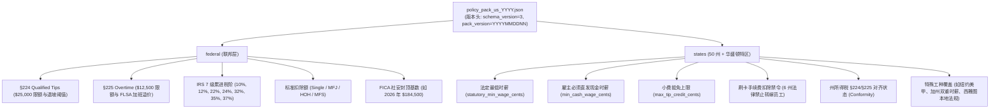

# TipCap 政策包与多语言热修包维护 SOP 手册

本文档是 TipCap 两大 OTA 静态数据包的**唯一长期维护操作手册**：
1. **财税与劳工政策包**：`assets/policy/policy_pack_us_YYYY.json` 与 `docs/policies/policy_pack_us_YYYY.json`（全美 50 州最低工资、小费抵扣、OBBBA §224/§225 联邦扣除额度与 IRS 7 级税阶）；
2. **多语言零提审热修覆写包**：`docs/l10n/l10n_overrides.json`（线上四语 `en/zh/es/vi` 文案快速纠错，无需重新提交 App Store / Google Play 审核）。

---

## 一、政策包 JSON 控制了什么？

文件位置：
- 本地资产：`assets/policy/policy_pack_us_2026.json`（App 离线内置）
- CDN 镜像：`docs/policies/policy_pack_us_2026.json`（线上 OTA 静默更新源）

每个 JSON 是该年度的**单一事实源 (SSOT)**，包含联邦层与州层两大模块：



---

## 二、政策包什么时候需要维护更新？

| 触发场景 | 发生时间 | 权威数据源 | 典型变更内容 |
| :--- | :--- | :--- | :--- |
| **IRS 年度通胀指数化税阶** | 每年 10 月 ~ 11 月 | [IRS.gov](https://www.irs.gov) Revenue Procedure | 调整下一年度 7 级税阶起征点、标准扣除额及 FICA 社安封顶额 |
| **州最低时薪生效** | 每年 12 月 / 1 月 1 日（部分州 7 月 1 日） | [DOL.gov Minimum Wage](https://www.dol.gov/agencies/whd/state/minimum-wage/tipped) 各州劳工厅公告 | 例如佛罗里达每年递增 $1，加州/纽约通胀微调，西雅图本地调薪 |
| **国会法案修订或落日延期** | 2028 ~ 2029 年落日评估期 | 国会法案公报 (IRC §224 / §225) | 评估法案是否延期或调整联邦扣除限额 |

---

## 三、政策包维护的三种实操方式

### 方式 1：局部微调某个州的最低工资或税率（最常见）

1. **编辑文件**：打开 `assets/policy/policy_pack_us_2026.json`；
2. **定位州代码**：搜索 `"NY"` 或 `"CA"`，修改金额（单位均为**美分**，如 `$17.50` 写为 `1750`）：
   ```json
   "statutory_min_wage_cents": 1750,
   "min_cash_wage_cents": 1185,
   "max_tip_credit_cents": 565
   ```
3. **严格递增 `pack_version`**：修改顶部 `pack_version`（格式 `YYYYMMDDNN`，例如 `2026112103` -> `2026112201`）；
   > 客户端只接受 `pack_version` 严格大于当前版本的包，用于防降级回滚攻击。
4. **同步到 `docs/`**：复制覆盖到 `docs/policies/policy_pack_us_2026.json`；
5. **签名并发布**（见第四节）。

### 方式 2：新增未来年份（如 2028、2029 规则包）

1. 在 `assets/policy/` 下复制 `policy_pack_us_2027.json` 并重命名为 `policy_pack_us_2028.json`；
2. 修改头部元数据：
   ```json
   {
     "schema_version": 3,
     "tax_year": 2028,
     "pack_version": 2028112101,
     "published_at": "2027-11-20T00:00:00Z",
     "public_audit_url": "https://wee91681-ops.github.io/tipcap/policies/policy_pack_us_2028.json"
   }
   ```
3. 录入当年 IRS 官方税阶与各州时薪，并复制一份到 `docs/policies/policy_pack_us_2028.json`；
4. 签名并发布（见第四节）。

> **免维护容灾机制**：若某年暂未发布新 JSON，TipCap 会自动离线平滑沿用最新已知年份包（如 2027），打卡、核薪与统计均正常运行。

### 方式 3：通过 Python 脚本批量构建

工程内置参数化构建脚本：[scripts/sign_policy_packs.py](../scripts/sign_policy_packs.py)
1. 修改脚本中 `raw_states` 列表对应的年度数值；
2. 运行 `python scripts/sign_policy_packs.py --generate`，自动同步生成 `assets/policy/` 与 `docs/policies/` 下所有 JSON。

---

## 四、政策包签名与 CDN 发布闭环（3 步走）

生产公钥已硬编码在客户端 `PolicyPackRepository.kPolicyEd25519PublicKeyHex` 中：
`ecf56f842cbefdf841212d4a9522822187002f6996e851d6fe2dc921ac98056e`

> **私钥安全铁律**：64 位十六进制 Ed25519 私钥种子 `TIPCAP_POLICY_SIGNING_SEED_HEX` 仅保存在维护者本地安全密码库或 CI Secret 中，**严禁写入代码或提交到 Git 仓库**。

### Windows PowerShell
```powershell
# 第一步：设置临时会话私钥环境变量并签名（关闭终端自动失效）
$env:TIPCAP_POLICY_SIGNING_SEED_HEX = "<你的64位十六进制私钥种子>"
python scripts/sign_policy_packs.py --sign

# 第二步：本地校验签名与生产公钥匹配性
python scripts/sign_policy_packs.py --verify-only --pubkey ecf56f842cbefdf841212d4a9522822187002f6996e851d6fe2dc921ac98056e

# 第三步：同步 docs/ 到 GitHub Pages 仓库并发布 CDN
python scripts/deploy_docs.py
```

### macOS / Linux Bash
```bash
export TIPCAP_POLICY_SIGNING_SEED_HEX="<你的64位十六进制私钥种子>"
python3 scripts/sign_policy_packs.py --sign
python3 scripts/sign_policy_packs.py --verify-only --pubkey ecf56f842cbefdf841212d4a9522822187002f6996e851d6fe2dc921ac98056e
python3 scripts/deploy_docs.py
```

---

## 五、客户端如何接收政策包？

1. **静默拉取**：App 启动后在后台请求 `https://wee91681-ops.github.io/tipcap/policies/policy_pack_us_{year}.json` 及配套 `.sig`；
2. **三道安全门禁**：校验 `schema_version == 3`、`pack_version > 本地版本` 以及内嵌不可变公钥 `ecf56f84...` 的 Ed25519 验签；
3. **即时生效**：全部通过后写入本地安全缓存，无需重提商店即可生效。

---

## 六、多语言零提审热修包 (`docs/l10n/l10n_overrides.json`) 完整维护 SOP

### 6.1 核心机制与生效地址
- **源文件**：`docs/l10n/l10n_overrides.json`
- **签名文件**：`docs/l10n/l10n_overrides.json.sig`
- **线上 CDN 地址**：
  - `https://wee91681-ops.github.io/tipcap/l10n/l10n_overrides.json`
  - `https://wee91681-ops.github.io/tipcap/l10n/l10n_overrides.json.sig`
- **验签密钥**：与政策包**完全共用同一把 Ed25519 私钥/公钥**（`TIPCAP_POLICY_SIGNING_SEED_HEX` -> 公钥 `ecf56f84...`）。
- **合规与容灾**：仅允许纯文本 `key -> string` 映射（严禁可执行逻辑，符合 Apple Guideline 2.5.2）；离线或拉不到 `.sig` 时 0ms 无感回退 App 内置词典。

### 6.2 两个标准执行时机
1. **提审前空包通车（推荐执行一次）**：
   正式提审 App Store / Google Play 前，保留 `overrides` 为空对象，对模板执行一次 `--sign`、`--verify-only` 和 `deploy_docs.py`。可提前验证 CDN 与验签链路完全畅通，且避免客户端冷启动请求 `.sig` 返回 404。
2. **线上紧急纠错（按需触发）**：
   App 上架后若发现某语言有错字、拗口或合规风险，按下方 5 步走，1 分钟内全球生效，无需发版提审。

### 6.3 线上热修文案 5 步实操

**第 1 步：查找精确的词条 `key`**
在 `lib/l10n/app_en.arb`（或 `app_zh.arb` / `app_es.arb` / `app_vi.arb`）中搜索当前 App 显示的旧文案，找到它对应的 JSON 键名（例如 `paycheckGuardTitle` 或 `deductibleCapYearTitle`）。
- **带占位符的词条规则**：如果原词条含 `{year}`、`{jobName}`、`{amount}` 等占位符，新文案中**必须保留完全一致的占位符名**（大小写一致）。例如：
  - 原词条：`"deductibleCapYearTitle": "{year} 年合格小费扣除进度"`
  - 覆写值：`"deductibleCapYearTitle": "{year} 年合格小费扣除追踪"`
- **合规红线检查**：修改后的文案严禁出现 `Form 4070A` / `4070-A`、`免税` / `Tax-free` / `0% Tax`、`防克扣` / `克扣底薪`；越南语必须用 `tiền tip`（禁用 `boa`）；西班牙语禁用英文残留 `Snapshot`。

**第 2 步：编辑 `docs/l10n/l10n_overrides.json` 并严格递增 `pack_version`**
```json
{
  "schema_version": 1,
  "pack_version": 2026112501,
  "updated_at": "2026-11-25",
  "notes": "Fix typo in zh paycheck title and vi expense button",
  "overrides": {
    "en": {},
    "zh": {
      "paycheckGuardTitle": "工资单核对"
    },
    "es": {},
    "vi": {
      "addExpenseButton": "Thêm chi phí"
    }
  }
}
```
> 注意：`schema_version` 固定为 `1`；`pack_version` 必须为**严格大于上一次线上版本的正整数**（推荐 `YYYYMMDDNN`，如当天第 1 次 `2026112501`，当天第 2 次 `2026112502`）。

**第 3 步：本地签名并校验（自动强制 LF 换行并检查 Key 拼写）**

Windows PowerShell：
```powershell
$env:TIPCAP_POLICY_SIGNING_SEED_HEX = "<你的64位十六进制私钥种子>"
python scripts/sign_l10n_overrides.py --sign
python scripts/sign_l10n_overrides.py --verify-only
```

macOS / Linux Bash：
```bash
export TIPCAP_POLICY_SIGNING_SEED_HEX="<你的64位十六进制私钥种子>"
python3 scripts/sign_l10n_overrides.py --sign
python3 scripts/sign_l10n_overrides.py --verify-only
```
看到输出 `OK: Verified .../docs/l10n/l10n_overrides.json (pack_version=...)` 即表示私钥与生产公钥 100% 匹配、JSON 格式合法、行尾为标准 LF。

**第 4 步：提交主仓库并发布到 GitHub Pages CDN**
```powershell
# 1. 保存源码记录到 TipCap 主仓库
git add docs/l10n/l10n_overrides.json docs/l10n/l10n_overrides.json.sig
git commit -m "chore(l10n): publish signed OTA l10n override pack v2026112501"
git push origin main

# 2. 同步 docs/ 到 GitHub Pages 静态 CDN 仓库（关键步骤！漏掉则线上拿不到新包）
python scripts/deploy_docs.py
```

**第 5 步：线上生效验收（等待 30~60 秒后执行）**
```powershell
curl.exe -s https://wee91681-ops.github.io/tipcap/l10n/l10n_overrides.json
curl.exe -s https://wee91681-ops.github.io/tipcap/l10n/l10n_overrides.json.sig
```
确认返回的 `pack_version` 已更新且 `.sig` 为 128 位十六进制签名后，重开客户端即可自动验签刷新生效。

### 6.4 如何撤回/回滚某条热修文案？
客户端禁止降级 `pack_version`，因此**切勿把 `pack_version` 改回旧数字**。正确撤回方法：
1. 在 `docs/l10n/l10n_overrides.json` 中**删除**对应语种下要撤回的 `key`（若全部撤回则恢复为空对象 `{}`）；
2. 将 `pack_version` **继续递增**（例如 `2026112501` -> `2026112502`）；
3. 重新执行 `--sign` -> `--verify-only` -> `git push` -> `python scripts/deploy_docs.py`；
4. 客户端收到更高版本号的新包后，未出现在 `overrides` 中的 `key` 会立即恢复为 App 内置默认文案。

### 6.5 常见踩坑与排查清单

| 现象 | 原因 | 解决方法 |
| :--- | :--- | :--- |
| 推完代码但手机端完全没更新 | 1) 忘了执行 `python scripts/deploy_docs.py` 同步到 Pages 仓库；2) `pack_version` 没比上一版大 | 检查 `curl` CDN 返回的 `pack_version`，递增版本号后重签并运行 `deploy_docs.py` |
| 客户端拉到了文件但验签失败被丢弃 | Windows 编辑器把 JSON 改成了 CRLF（`\r\n`）且未重新签名，导致与 GitHub Pages 的 LF 字节不一致 | `.gitattributes` 已锁定 `docs/l10n/** text eol=lf`，重跑 `sign_l10n_overrides.py --sign` 会自动转为 LF 并重签 |
| 某条热修文案不生效，其他条生效 | `key` 拼写错误，或新发版才加的 key 在老版本 App 中不存在 | 留意 `--sign` 输出的 `WARNING: ... not found in lib/l10n/app_en.arb`，核对 `lib/l10n/app_en.arb` 精确键名 |
| 文案里原样显示了 `{year}` 字样 | 覆写文本里的占位符名写错（如把 `{year}` 写成了 `{taxYear}`） | 严格对照 `app_en.arb` 中对应的 `@key` 元数据占位符名修改并重签 |

---

## 七、正常发版修改 `.arb` 词典时的必做同步命令

平时迭代版本直接修改 `lib/l10n/app_{en,zh,es,vi}.arb` 新增或修改词条后，**必须**成对执行以下两条命令，否则 OTA 覆写代理类 `OverridableAppLocalizations` 会漏掉新增词条或编译报错：

```powershell
flutter gen-l10n
python scripts/gen_l10n_overlay.py
```

随后检查 `build/l10n_untranslated.txt` 必须为 `{}`，并把热修包 `docs/l10n/l10n_overrides.json` 中已经合入新版本的旧临时覆盖项适时清理（等旧版用户升级完毕后）。
