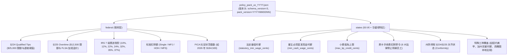

# TipCap 财税与劳工政策包 (Policy Pack JSON) 维护 SOP 手册

本文档专门指导未来如何维护、更新和发布 `policy_pack_us_YYYY.json`（即控制全美 50 州最低工资、小费抵免、2026/2027+ 国会 OBBBA 免税额度与 IRS 7 级累进税阶的核心规则包）。

---

## 一、那个 JSON 究竟控制了什么？

文件位置：
- 本地资产：`assets/policy/policy_pack_us_2026.json`（App 离线内置）
- CDN 镜像：`docs/policies/policy_pack_us_2026.json`（线上 OTA 静默更新源）

每个 JSON 是该年度的**单一事实源 (SSOT)**，主要包含两大模块：



---

## 二、什么时候需要维护更新？

| 触发场景 | 发生时间 | 权威数据源 | 典型变更内容 |
| :--- | :--- | :--- | :--- |
| **IRS 年度通胀指数化税阶** | 每年 10 月 ~ 11 月 | [IRS.gov](https://www.irs.gov) Revenue Procedure (如 Rev. Proc. 2025-32 / 2026-35) | 调整下一年度 7 级税阶起征点、标准扣除额以及 FICA 社安封顶额 |
| **州最低时薪生效** | 每年 12 月 / 1 月 1 日 (部分州 7 月 1 日) | [DOL.gov Minimum Wage](https://www.dol.gov/agencies/whd/state/minimum-wage/tipped) 各州劳工厅公告 | 例如佛罗里达每年递增 $1，加州/纽约通胀微调，西雅图本地调薪 |
| **国会法案修订或落日延期** | 2028 ~ 2029 年落日评估期 | 美联社/国会法案公报 (IRC §224 / §225) | 评估国会是否延期该法案，或调整免税上限金额 |

---

## 三、未来维护的三种实操方式

### 方式 1：局部微调某个州的最低工资或税率（最常见）

**示例**：加州或纽约在新年将最低时薪上调了 $0.50。
1. **直接编辑文件**：打开 `assets/policy/policy_pack_us_2026.json`；
2. **定位州代码**：搜索 `"NY"` 或 `"CA"`，修改其中的金额（以**美分为单位**，例如 `$17.50` 写为 `1750`）：
   ```json
   "statutory_min_wage_cents": 1750,
   "min_cash_wage_cents": 1185,
   "max_tip_credit_cents": 565
   ```
3. **递增版本号（极重要）**：修改顶部的 `pack_version`，确保数值严格递增（例如从 `2026112103` 改为 `2026112201`）；
   > 客户端只接受 `pack_version` 大于当前本地版本的规则包（防回滚安全攻击）。
4. **同步到 docs**：将修改后的文件复制覆盖到 `docs/policies/policy_pack_us_2026.json`；
5. **签名并推送**（见第四节）。

---

### 方式 2：新增未来年份（如 2028、2029 规则包）

**示例**：跨入 2028 年，需要提供 2028 年专属规则包。
1. **复制模板**：在 `assets/policy/` 下复制一份 `policy_pack_us_2027.json`，重命名为 `policy_pack_us_2028.json`；
2. **修改头部元数据**：
   ```json
   {
     "schema_version": 3,
     "tax_year": 2028,
     "pack_version": 2028112101,
     "published_at": "2027-11-20T00:00:00Z",
     "public_audit_url": "https://wee91681-ops.github.io/tipcap/policies/policy_pack_us_2028.json"
   }
   ```
3. **录入 IRS 2028 官方税阶与各州时薪**；
4. **复制一份到 docs**：放一份到 `docs/policies/policy_pack_us_2028.json`；
5. **签名并推送**（见第四节）。

> **💡 免维护容灾机制**：如果某年您未及时发布新 JSON，TipCap 已经具备**离线平滑兜底机制**，会自动安全沿用最新已知年份包（如 2027），用户端打卡、工资单核算、小费统计均 100% 正常运行，绝不崩溃！

---

### 方式 3：通过 Python 自动化生成器批量构建

工程内置了全量参数化构建脚本：[scripts/sign_policy_packs.py](file:///d:/wwwroot/work/Tipcap/scripts/sign_policy_packs.py)
1. 打开 `scripts/sign_policy_packs.py`，在 `raw_states` 列表中直接修改或新增各州的年度数值元组；
2. 运行构建命令：
   ```bash
   python scripts/sign_policy_packs.py --generate
   ```
   脚本会自动重新生成 `assets/policy/` 和 `docs/policies/` 下的所有格式化 JSON。

---

## 四、签名与发布上线闭环（核心发布 3 步走）

每次修改 JSON 之后，必须经过**数字签名**与**CDN 发布**，App 才能静默热更：

```bash
# 第一步：为新 JSON 签署 Ed25519 密码学生产签名 (生成配套 .sig 文件)
# 说明：若设置了私钥环境变量 TIPCAP_POLICY_SIGNING_SEED_HEX，执行签名：
python scripts/sign_policy_packs.py --sign

# 第二步：本地自校验签名与公钥匹配性 (确保 100% 验签通过)
python scripts/sign_policy_packs.py --verify-only --pubkey ecf56f842cbefdf841212d4a9522822187002f6996e851d6fe2dc921ac98056e

# 第三步：一键同步发布到 GitHub Pages 全球 CDN
python scripts/deploy_docs.py
```

---

## 五、客户端如何自动接收新 JSON？

一旦完成上述发布：
1. **静默拉取**：用户打开 TipCap 时，后台服务会在空闲时向 `https://wee91681-ops.github.io/tipcap/policies/policy_pack_us_{year}.json` 发起轻量 ETag 条件请求；
2. **三道安全门禁验证**：
   - 门禁 ①：检查 `schema_version == 3`；
   - 门禁 ②：检查 `pack_version > 当前本地版本`（防止降级回滚）；
   - 门禁 ③：使用本地内嵌不可变公钥 `ecf56f84...` 对下载的数据及 `.sig` 进行 **Ed25519 验签**；
3. **无缝热更**：三道门禁全部通过后，新规则立即写入安全缓存，**用户无需去 App Store 强更 App**，次日计算与报税指标即刻按照最新税收法案生效！
